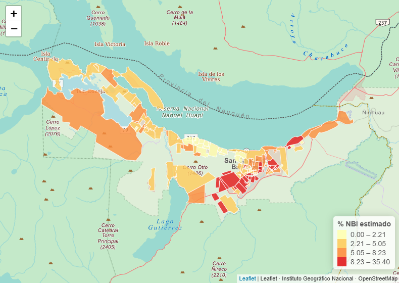
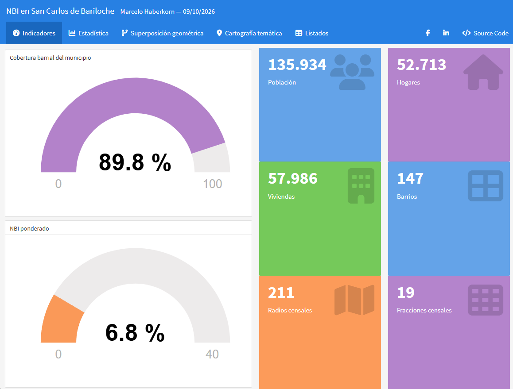

\# Necesidades Básicas Insatisfechas en San Carlos de Bariloche

\### Análisis espacial, cartografía temática y visualización interactiva con R

\*\*Autor:\*\* Marcelo Haberkorn  

\*\*Año:\*\* 2026  

\*\*Área de estudio:\*\* San Carlos de Bariloche, Río Negro, Argentina.

\## Descripción

Este proyecto presenta un análisis exploratorio y espacial de las Necesidades Básicas Insatisfechas (NBI) en San Carlos de Bariloche, utilizando información censal y herramientas de análisis geoespacial.

El trabajo integra procesamiento de información geográfica, análisis estadístico, operaciones espaciales y elaboración de cartografía temática.

Se desarrollaron dos productos complementarios:

1\. Un reporte técnico reproducible mediante R Markdown.

2\. Un tablero interactivo para explorar indicadores estadísticos y territoriales.

\## Objetivos

\- Analizar la distribución territorial de los indicadores de NBI.

\- Explorar relaciones entre variables censales.

\- Integrar distintas unidades de análisis espacial.

\- Aplicar técnicas de superposición e interpolación areal.

\- Representar los resultados mediante cartografía temática.

\- Desarrollar herramientas interactivas de visualización.

\## Herramientas utilizadas

\*\*Lenguaje:\*\* R

\*\*Principales paquetes:\*\*

\- sf

\- dplyr

\- tidyr

\- ggplot2

\- leaflet

\- leaflet.minicharts

\- flexdashboard

\- DT

\- knitr

\*\*Tecnologías complementarias:\*\*

\- R Markdown

\- HTML

\- GeoJSON

\- ArgenMap / IGN

\## Metodología

El análisis utiliza información geográfica correspondiente a radios censales, barrios y límite municipal de San Carlos de Bariloche.

Se aplicaron técnicas de procesamiento de datos, análisis estadístico y operaciones geométricas mediante el paquete sf.

Para explorar la distribución de indicadores por barrios se implementó una interpolación areal ponderada por superficie.

Los resultados obtenidos mediante este procedimiento constituyen estimaciones exploratorias y no deben interpretarse como valores censales observados directamente para cada barrio.

\## Productos desarrollados

\### 1. Reporte técnico

Documento que integra:

\- Descripción de fuentes y atributos.

\- Análisis estadístico exploratorio.

\- Análisis bivariado.

\- Procesamiento de geometrías.

\- Cartografía temática.

\- Interpretación territorial.

\- Limitaciones metodológicas y conclusiones.

#### Cartografía temática del reporte

*Figura 1. Distribución espacial del porcentaje estimado de NBI por barrio en San Carlos de Bariloche. Elaboración propia mediante R, sf y Leaflet. Los valores corresponden a estimaciones obtenidas mediante interpolación areal ponderada por superficie.*

\### 2. Tablero interactivo

Herramienta de visualización desarrollada mediante Flexdashboard que incorpora:

\- Indicadores estadísticos.

\- Gráficos interactivos.

\- Mapas temáticos mediante Leaflet.

\- Exploración de información territorial.

\- Tablas de consulta.

#### Panel de indicadores

*Figura 2. Panel de indicadores del tablero interactivo desarrollado con R y Flexdashboard. Integra información estadística y territorial mediante indicadores dinámicos y elementos de visualización.*

## Fuentes de información

Para el desarrollo del proyecto se utilizaron fuentes cartográficas
y estadísticas oficiales:

- Instituto Nacional de Estadística y Censos (INDEC).
- Dirección de Estadística y Censos de Río Negro.
- Instituto Geográfico Nacional (IGN).
- Municipalidad de San Carlos de Bariloche.

### Cartografía de barrios

La capa de barrios de San Carlos de Bariloche fue proporcionada
por el Departamento de Estadísticas y Gestión de la Información
de la Municipalidad de San Carlos de Bariloche.

La información fue recibida originalmente en formato KML,
con referencia temporal al año 2023, y posteriormente
convertida a GeoJSON para su procesamiento mediante R.

**Organismo proveedor:**
Municipalidad de San Carlos de Bariloche.

**Área:**
Departamento de Estadísticas y Gestión de la Información.

**Contacto institucional:**
estadisticas.mscb@gmail.com

**Cartografía municipal publicada:**
https://www.bariloche.gov.ar/mapasdebariloche/

La transformación de formato y los procedimientos de análisis
espacial realizados en este proyecto son de elaboración propia.

### Consideraciones metodológicas

Las estimaciones de NBI por barrio se obtuvieron mediante
interpolación areal ponderada por superficie.

Estos resultados deben interpretarse como estimaciones
exploratorias y no como valores censales oficiales calculados
directamente para cada barrio.

La documentación detallada de las fuentes, procedimientos
y limitaciones metodológicas se encuentra en el reporte técnico.

\## Reproducibilidad

Los archivos R Markdown, los datos y los resultados generados se encuentran organizados dentro de la carpeta `proyecto`.

Para regenerar los documentos es necesario contar con R, los paquetes correspondientes y los archivos geográficos utilizados.

\## Autor

\*\*Marcelo Haberkorn\*\*

Cartografía, Sistemas de Información Geográfica, teledetección y análisis de datos geoespaciales.

\[Perfil de GitHub](https://github.com/marcelohaberkorn)

